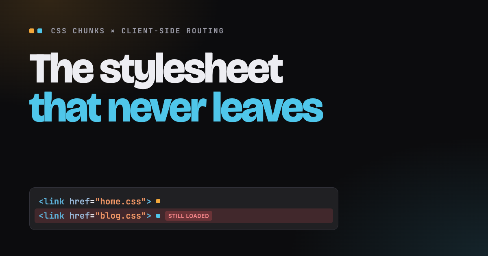

# The stylesheet that never leaves

An interactive explainer about a CSS bug that many single-page apps have:
**CSS chunking puts each page's CSS in the right order, but client-side routing stacks those chunks in the order the user clicks.**

**[Read it →](https://jantimon.github.io/demo-css-load-order/)**



## What the page shows

1. **Why split CSS at all.** The browser paints nothing until the CSS in `<head>` has loaded. A 30 KB chunk paints long before a 400 KB bundle.
2. **A simple example.** `Home.tsx` and `Blog.tsx` both render the same `<Header>`. The bundler copies `header.css` into `home.css` and into `blog.css`. Each chunk is correct on its own.
3. **Clicking through the site.** Home → Blog → Home. `blog.css` is never removed, it now loads last, and its `.header` beats `.header-over-hero`. The header turns into a blank white bar. A reload fixes it, which is why QA rarely sees it.
4. **Why it is hard to fix.**
   - A CSS import runs once, rendering runs many times, and nothing connects the two, so the router can't know when to remove a stylesheet.
   - Shared CSS lands in the cascade twice, and the copy that loads last wins.
   - `@layer` doesn't help: unlayered rules beat layered ones, so state rules such as `:disabled` start to lose.
   - A priority per file would need the whole import graph, and one new import changes the priority of every file above it.

## Run it

It is a static page with no build step:

```sh
npx serve .
```

or open `index.html` in a browser.

Append `?step=2` to the URL to open the browser and DevTools animation (Fig. 3) at a given step, for slides or screenshots.

## Files

| File | What it holds |
| --- | --- |
| `index.html` | All content and markup |
| `styles.css` | Design tokens, layout, every figure |
| `main.js` | The animations, one block per figure |
| `assets/hero.webp` | Hero image of the made-up site "Ember Ridge" |
| `assets/og.png` | Social card, 1200 × 630 |
| `AGENTS.md` | Notes for coding agents that build explainers like this one |

## Author

Jan Nicklas ([@jantimon](https://github.com/jantimon)) on [Bluesky](https://bsky.app/profile/jantimon.bsky.social), [X](https://x.com/jantimon) and [GitHub](https://github.com/jantimon). Feel free to reach out.
